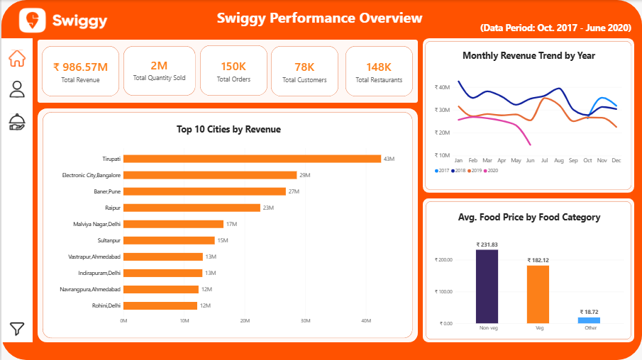
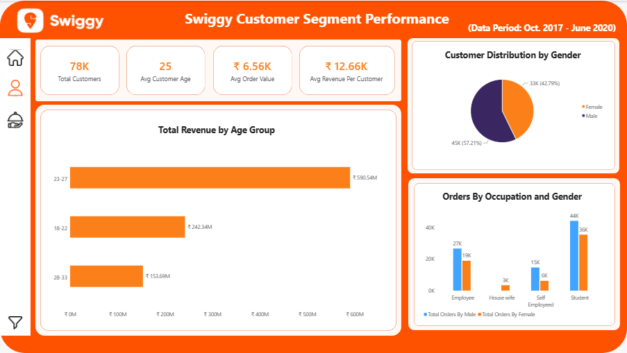
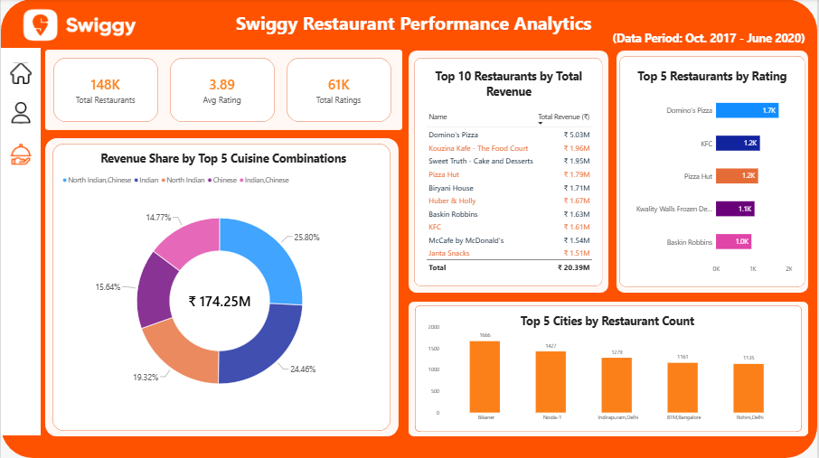

# Swiggy Performance Analytics Dashboard | Power BI

## Project Overview
An interactive Power BI project built to analyze Swiggy performance across three report pages: **Performance Overview**, **Customer Segment Analysis**, and **Restaurant Performance Analytics**.

**Data period:** October 2017 – June 2020

## Dashboard Screenshots

### 1. Performance Overview

This page summarizes business performance with KPI cards, monthly revenue trends, top cities by revenue, and average food price by food category.

**KPIs and visuals shown:**
- Total revenue: **₹986.57M**
- Quantity sold: approximately **2M**
- Total orders: **150K**
- Total customers: **78K**
- Total restaurants: **148K** (validate whether this is a distinct restaurant count or a row count)
- Top 10 cities by revenue
- Monthly revenue trend by year
- Average food price by category: Non-veg **₹231.83**, Veg **₹182.12**, Other **₹18.72**

### 2. Customer Segment Analysis

This page explores customer demographics and order/revenue patterns by age group, gender, and occupation.

**KPIs and visuals shown:**
- Total customers: **78K**
- Average customer age: **25**
- Average order value: **6.56K**
- Average revenue per customer: **12.66K**
- Customer gender split: Male **45K (57.21%)**, Female **33K (42.79%)**
- Revenue by age group: ages **23–27: ₹0.59B**, **18–22: ₹0.24B**, **28–33: ₹0.15B**
- Orders by occupation and gender

### 3. Restaurant Performance Analytics

This page compares restaurant and cuisine performance using revenue, ratings, and city-level visuals.

**KPIs and visuals shown:**
- Total restaurants: **148K** (validate distinct count versus row count)
- Average rating: **4** as displayed on this page
- Total ratings: **61K**
- Top 5 cuisines by total revenue; displayed total across the visual: **174.25M**
- Top 10 restaurants by total revenue; displayed combined total: **20.39M**
- Top 5 restaurants by rating
- Top 5 restaurants by city

## Tools & Techniques
- **Power BI Desktop** — report development and interactive visuals
- **Power Query** — data preparation and transformation
- **DAX** — measures and KPI calculations, where applicable
- KPI cards, bar/column charts, donut chart, tables, and slicers

## Key Analysis Areas
- Reviewed revenue trends over time and compared city-level revenue.
- Compared average food prices across food categories.
- Explored customer distribution and revenue by age group, gender, and occupation.
- Compared restaurant performance using revenue and rating measures.
- Used report filters to explore data by year and other available dimensions.

## How to Use
1. Download or clone this repository.
2. Open `Swiggy-Analysis.pbix` in Microsoft Power BI Desktop (if the PBIX file is included in the repository).
3. Navigate between the three report pages and use available slicers to explore the report.

## Data Notes
Figures above are transcribed from the dashboard screenshots. Some KPI labels and aggregations should be validated against the final Power BI model before making business claims. In particular, verify whether **148K Total Restaurants** is a distinct restaurant count or a count of restaurant-table rows. Confirm currency/units and formatting for all revenue measures before publishing.

## Disclaimer
This is a portfolio project for learning and demonstration purposes. Results depend on the source data, data-cleaning decisions, relationships, and measure definitions.
